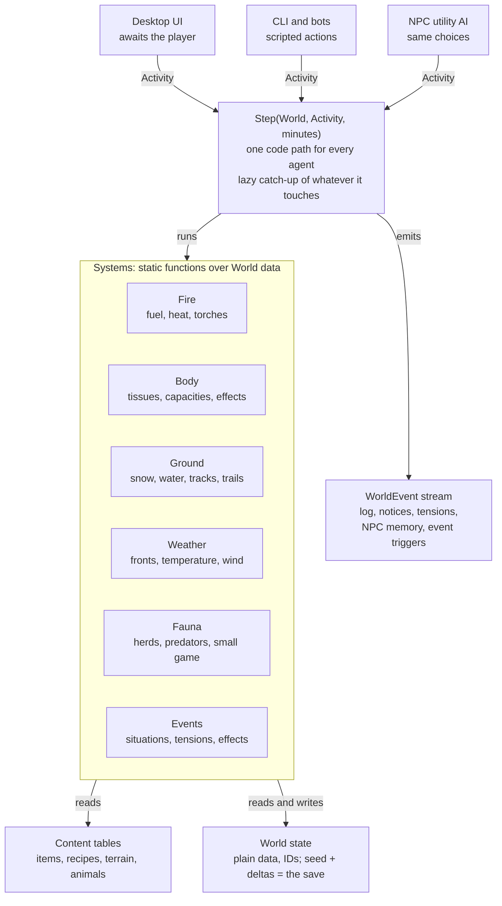

# Clean-Room Architecture

*A proposal for rebuilding the game's architecture from scratch. Keep the design and the physics; rebuild the plumbing.*

---

## Why Rebuild

The codebase is about 75k lines of source and 13.5k of tests. Its systems are sound ideas joined in ways that make every change expensive.

| Problem | Where | Cost today |
| --- | --- | --- |
| God object | `GameContext` (914 lines): player, map, UI, travel, combat, notices, hazard-prompt memory | Everything couples to everything; it is also the save format, patched with `[JsonIgnore]` |
| Whole-graph saves | `SaveManager` serializes `GameContext` by reflection | ~28MB saves; object references instead of IDs |
| Two action systems | Player: Handlers + WorkStrategies + Runners. NPCs: `NPCAction` subclasses (`NPC.cs` 1,816 lines) | Every behavior is written twice or half-shared; NPCs can't do what players can |
| Bag-of-fields outcomes | `EventResult`: ~40 optional fields, one 650-line `Apply` | Each new effect edits a central class in two places |
| Content as code | `LocationFactory` 2,769 lines, `NeedCraftingSystem` 1,833, ~20 event registry partials | Can't validate, diff or tune without recompiling |
| Three clocks | Player per-minute, tiles in quarter-hour batches, erosion accumulator | Each special case has its own invariants to keep in sync |

---

## Target Architecture

Eight decisions, each removing one of the problems above. Together they make the simulation a deterministic, headless library that the UI only drives.

### 1. The world is plain data; systems are functions

```csharp
record World(int Seed, long Minute, WeatherState Weather,
             Dictionary<TileId, TileState> Tiles,   // only tiles that differ from generation
             Dictionary<AgentId, Agent> Agents,     // the player is Agents[PlayerId]
             Dictionary<HerdId, Herd> Herds,
             List<Tension> Tensions);
```

- References are IDs, never object pointers. The save is the `World`.
- Terrain regenerates from `Seed`; saves hold only deltas, so hundreds of KB, not 28MB.
- Systems are static modules over this data: `Fire`, `Body`, `Ground`, `Weather`, `Fauna`, `Narrative`.

### 2. One activity model for player and NPCs

```csharp
abstract record Activity(AgentId Who, int Minutes);  // Forage, Chop, Travel, TendFire, Sleep, Craft...
static StepResult Step(World w, Activity a, int minutes);
```

- The UI and the NPC utility AI both just choose the next `Activity`. Everything after that is shared.
- `Step` returns `Interrupted(reason)`: the player gets an event, an NPC re-plans.
- Threat response and cooperation come almost free, because NPCs run the player's code.

### 3. Lazy catch-up instead of batch scheduling

- Tiles, herds and distant NPCs store `LastUpdatedMinute` and catch up on observation, in bounded sub-steps against recorded weather history.
- Distant actors step hourly; near the player, per minute.
- Replaces quarter-hour batching, the erosion special case, and the settle-before-move rule.

### 4. Simulation emits typed facts; consumers subscribe

```csharp
abstract record WorldEvent;  // FireDied, Injured, Witnessed, TrackLeft, ...
```

- `Step` returns `List<WorldEvent>`. Log, notices, tensions, relationship memory, toasts and event triggers all read the same stream.
- Replaces `ctx.Notices`, `NarrativeLog` plumbing and `RelationshipEvents` routing. Replays and debug traces come with it.

### 5. Event effects are small composable records

```csharp
abstract record Effect { public abstract void Apply(World w, AgentId who, Outcome o); }
record AddCondition(EffectKind Kind, double Severity) : Effect;
record Damage(double Amount, DamageType Type, BodyTarget Target) : Effect;
record Tension(string Type, double Delta) : Effect;
```

- A new effect is one new type; nothing central changes. Outcome templates like `.Frightening()` stay as sugar.
- Events stay in C#, because their conditions really are code.

### 6. Tables become data; logic stays code

- Items, recipes, terrain, animals, named locations and loot or discovery pools load from JSON or TOML.
- One test loads all content and checks every reference resolves: "never fail silently" enforced in one place.
- No event scripting language. It would grow into a bad programming language.

### 7. One knowledge model per agent

- Player map memory, discovered features, readable tracks and NPC `ResourceMemory` are one thing: an agent's beliefs.
- The UI renders the player's beliefs, not the truth. NPCs can be wrong.

### 8. Deterministic and headless by default

- Seeded RNG stream per system; no UI dependency in the core.
- CLI, NPC sim, balance harness and playtest bots drive the same core. A bug report is a seed plus an action list.

---

## Module Map

Dependencies point down only: front ends know the core, the core never knows a front end.



Rules a test enforces: no system references another system's state directly; nothing below `Step` awaits or touches UI; `World` holds IDs, never object references.

---

## Keep, Port, Cut

Port the tuned formulas and the authoring vocabulary; drop distinctions the player never sees.

| Decision | What | Why |
| --- | --- | --- |
| Keep | Async/await control flow (`await ui.Select(...)`) | Already the right shape; becomes the thin layer that picks `Activity` |
| Keep | Situations, Tensions, Variants, outcome templates | Good authoring vocabulary; re-targeted at `Effect` records |
| Keep | `.pxa` pixel-art pipeline | Independent and working |
| Port | Two-mass fire, heat transfer, `GroundSurface` layers, track and trail wear | Tuned physics; move formulas and their tests, not the classes |
| Port | Tactical combat grid | Same mode, built on shared `Body` and `Activity` |
| Cut | Serpentine, arachnid and flying bodies | An Ice Age game needs humans and quadrupeds |
| Cut | `TorchHandler` as its own system | A torch is a carried heat-and-light source in `Fire` |
| Merge | Harvestable, Forage, WoodedArea, Salvage, EnvironmentalDetail | All are a pool on a tile that work draws from, with different parameters |

---

## Build Order

Build a fresh `Core` project beside the old one and stop at any gate with a playable game. The current tests on the physics formulas are the spec.

| Phase | Scope | Gate |
| --- | --- | --- |
| 1. Core skeleton | `World`, `Activity`, `Step`, `WorldEvent` stream; Fire and Body ported; player at camp in the CLI | Ported fire and heat tests pass; save round-trips under 1 MB |
| 2. Map and travel | Seeded grid, Ground, Weather, lazy catch-up; hazardous travel; tracks and trails | 30-day headless run completes; same seed + actions = same world |
| 3. Fauna and NPCs | Herds and predators on `Step`; NPC utility AI; combat grid on the shared `Body` | An NPC survives 14 days alone; a pack hunt resolves headless |
| 4. Events and content | `Effect` records, Situations, Tensions; tables moved to data files; events ported | Every content reference resolves; every event has 2+ choices |
| 5. Desktop front end | Async driver over `Step`; pixel-art renderers; UI draws the player's knowledge, not the truth | Feature-parity checklist done; old project retired |

The CLI is the first front end, so every phase is playable and testable before any rendering exists. Durations are open: size each phase after phase 1 shows the real porting speed.
