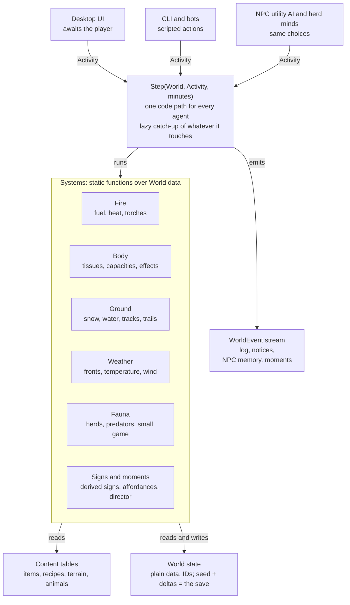

# Clean-Room Architecture

*A proposal for rebuilding the game's architecture from scratch. Keep the design and the physics; rebuild the plumbing.*

---

## Why Rebuild

The codebase is about 75k lines of source and 13.5k of tests. Its systems are sound ideas joined in ways that make every change expensive.

| Problem | Where | Cost today |
| --- | --- | --- |
| God object | `GameContext` (914 lines): player, map, UI, travel, combat, notices, hazard-prompt memory | Everything couples to everything; it is also the save format, patched with `[JsonIgnore]` |
| Whole-graph saves | `SaveManager` serializes `GameContext` by reflection | ~28MB saves; object references instead of IDs |
| Two action systems | Player: Handlers + WorkStrategies + Runners. NPCs: `NPCAction` subclasses (`NPC.cs` 1,816 lines) | Every behavior is written twice or half-shared; NPCs can't do what players can |
| Bag-of-fields outcomes | `EventResult`: ~40 optional fields, one 650-line `Apply` | Each new effect edits a central class in two places |
| Content as code | `LocationFactory` 2,769 lines, `NeedCraftingSystem` 1,833, ~20 event registry partials | Can't validate, diff or tune without recompiling |
| Three clocks | Player per-minute, tiles in quarter-hour batches, erosion accumulator | Each special case has its own invariants to keep in sync |

---

## Target Architecture

Eight decisions, each removing one of the problems above. Together they make the simulation a deterministic, headless library that the UI only drives.

### 1. The world is plain data; systems are functions

```csharp
record World(int Seed, long Minute, WeatherState Weather,
             Dictionary<TileId, TileState> Tiles,   // only tiles that differ from generation
             Dictionary<AgentId, Agent> Agents);    // the player, NPCs and herds alike
```

- References are IDs, never object pointers. The save is the `World`.
- Terrain regenerates from `Seed`; saves hold only deltas, so hundreds of KB, not 28MB.
- Systems are static modules over this data: `Fire`, `Body`, `Ground`, `Weather`, `Fauna`, `Narrative`.

### 2. One agent model and one activity model for player, NPCs and herds

```csharp
class Agent {
    AgentId Id; TileId Tile; Species Species;
    List<BodyState> Members;   // player and NPCs: one; a herd: many
    Mind Mind;                 // PlayerMind | NpcMind | HerdMind(Territory, State, Hunger, Fear)
    BodyState Body => Members.Single();   // derived, for one-body agents
}
abstract record Activity(AgentId Who);  // Forage, Chop, Travel, TendFire, Sleep, Graze, Patrol...
static StepResult Step(World w, Activity a, int minutes);
```

- An agent is one or more bodies that move and decide as a unit. A herd is an agent with many members; there is no separate herd type.
- The UI, the NPC utility AI and the herd behaviors (prey, pack, solitary) all just choose the next `Activity`. Everything after that — travel, tracks, trail wear, lazy catch-up, combat entry — is shared.
- `Step` returns `Interrupted(reason)`: the player gets an event, an NPC or herd re-plans.
- Threat response and cooperation come almost free, because NPCs run the player's code.
- Splitting falls out: a wounded animal leaving its herd is a new agent with one member; a herd sends members, not itself, into a fight.
- Kind-specific state lives in the `Mind` record, never as optional fields on `Agent`; shared code touches only `Tile` and `Members`.
- Animal members do not run the full human survival model. They take damage, bleed and die; hunger and fear are herd-level on `HerdMind`, as in the old game. Thermoregulation, wetness and needs are for human members.

### 3. Lazy catch-up instead of batch scheduling

- Tiles, herds and distant NPCs store `LastUpdatedMinute` and catch up on observation, in bounded sub-steps against recorded weather history.
- Distant actors step hourly; near the player, per minute.
- Replaces quarter-hour batching, the erosion special case, and the settle-before-move rule.

### 4. Simulation emits typed facts; consumers subscribe

```csharp
abstract record WorldEvent;  // FireDied, Injured, Witnessed, TrackLeft, ...
```

- `Step` returns `List<WorldEvent>`. Log, notices, relationship memory, toasts and moments all read the same stream.
- Replaces `ctx.Notices`, `NarrativeLog` plumbing and `RelationshipEvents` routing. Replays and debug traces come with it.

### 5. Content emerges from the simulation; tensions are derived, not tracked

**Superseded design (2026-11-20): see [emergent-world-design.md](emergent-world-design.md).**

- Tensions are not stored. Each old tension (Stalked, WoundedPrey, FoodScentStrong...) is real state: a pack whose mind follows you, a split-off wounded animal, meat in your pack. What the player feels is their *belief* about it (decision 7).
- Authored events become **moments**: a real dynamic crosses a threshold the player can perceive, and the choices are verbs derived from what is present (thing tags x carried capabilities), emitted as ordinary `Activity` records.
- Discovery content comes from a **settling pass** at world generation: the real sim run forward a year or two, leaving signs with one hop of cause.
- Rule: any event or discovery this system can replace, it replaces. What is left is catalogued and migrated later as authored content.

### 6. Tables become data; logic stays code

- Items, recipes, terrain, animals, named locations and loot or discovery pools load from JSON or TOML.
- One test loads all content and checks every reference resolves: "never fail silently" enforced in one place.
- No event or rules scripting language. It would grow into a bad programming language. The one data-driven rule set is the small affordance table (emergent-world-design.md §3.4).

### 7. One knowledge model per agent

- Player map memory, discovered features, readable tracks, NPC `ResourceMemory` and a herd's learned fear are one thing: an agent's beliefs.
- The UI renders the player's beliefs, not the truth. NPCs can be wrong.

### 8. Deterministic and headless by default

- Seeded RNG stream per system; no UI dependency in the core.
- CLI, NPC sim, balance harness and playtest bots drive the same core. A bug report is a seed plus an action list.

---

## Module Map

Dependencies point down only: front ends know the core, the core never knows a front end.



Rules a test enforces: no system references another system's state directly; nothing below `Step` awaits or touches UI; `World` holds IDs, never object references.

---

## Keep, Port, Cut

Port the tuned formulas and the authoring vocabulary; drop distinctions the player never sees.

| Decision | What | Why |
| --- | --- | --- |
| Keep | Async/await control flow (`await ui.Select(...)`) | Already the right shape; becomes the thin layer that picks `Activity` |
| Cut | Tensions, most authored events, outcome templates | Replaced by derived state, signs and moments ([emergent-world-design.md](emergent-world-design.md)); leftovers catalogued for later migration |
| Keep | `.pxa` pixel-art pipeline | Independent and working |
| Port | Two-mass fire, heat transfer, `GroundSurface` layers, track and trail wear | Tuned physics; move formulas and their tests, not the classes |
| Port | Tactical combat grid | Same mode, built on shared `Body` and `Activity` |
| Cut | Serpentine, arachnid and flying bodies | An Ice Age game needs humans and quadrupeds |
| Cut | `TorchHandler` as its own system | A torch is a carried heat-and-light source in `Fire` |
| Merge | Harvestable, Forage, WoodedArea, Salvage, EnvironmentalDetail | All are a pool on a tile that work draws from, with different parameters |
| Merge | `Herd` into `Agent` | A herd is an agent with many members; one Step, travel and tracks path instead of two |

---

## Build Order

Build a fresh `Core` project beside the old one and stop at any gate with a playable game. The current tests on the physics formulas are the spec.

| Phase | Scope | Gate |
| --- | --- | --- |
| 1. Core skeleton | `World`, `Activity`, `Step`, `WorldEvent` stream; Fire and Body ported; player at camp in the CLI | Ported fire and heat tests pass; save round-trips under 1 MB |
| 2. Map and travel | Seeded grid, Ground, Weather, lazy catch-up; hazardous travel; tracks and trails | 30-day headless run completes; same seed + actions = same world |
| 3. Fauna and NPCs | Herd minds (prey, pack, solitary) and NPC utility AI choosing activities for multi-member agents; combat grid on the shared `Body` | An NPC survives 14 days alone; a pack hunt resolves headless; a wounded animal splits into its own agent |
| 4. World content | Named places, the crossing, shelters and bedding; tables moved to data files; then the emergent-world build order ([emergent-world-design.md](emergent-world-design.md) §9): tools, substrate, kill chain and settling pass, affordances and moments, full interaction table, travellers | Every content reference resolves; a settled valley meets the find-distribution targets; no find offers zero verbs; leftover authored content catalogued |
| 5. Desktop front end | Async driver over `Step`; pixel-art renderers; UI draws the player's knowledge, not the truth | Feature-parity checklist done; old project retired |

The CLI is the first front end, so every phase is playable and testable before any rendering exists. Durations are open: size each phase after phase 1 shows the real porting speed.
