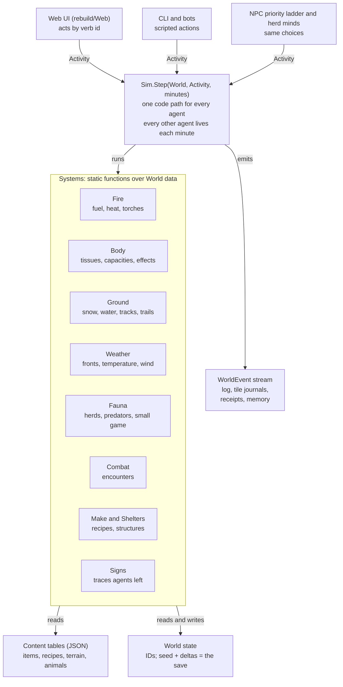

# Clean-Room Architecture

*A proposal for rebuilding the game's architecture from scratch. Keep the design and the physics; rebuild the plumbing.*

The rebuild lives in `rebuild/`: the simulation in `rebuild/Sim`, its tests in `rebuild/Sim.Tests`,
the browser front end in `rebuild/Web`, a CLI in `rebuild/Cli` and the tuner in `rebuild/Tools/Tune`.
"Where things go" below is the rule for new work. The sections after it are the original proposal;
where the code or a decision has moved past it, the text says so in a **Superseded** note.

---

## Where things go

Read this before adding any feature. A **feature** is anything the player meets: a location,
weather type, animal, recipe, effect, condition, item, verb, terrain, discovery and so on
(`GLOSSARY.md`).

### The rules

- **A system owns one set of rules over world data, and its rules live only there.** Everything
  else asks it.
- **Wiring between systems belongs to the system that makes the decision.** The system that
  provides an input publishes one plain read or forecast, never its internals. A combination two
  systems both need is its own rule: a system or a forecast. Example: fire deterrence lives in
  Combat (`CombatAI.FireDeterrence`) and reads `Fire.IntensityPct`.
- **Forecasts** are rough and probabilistic. They assume everything else stays as it is. The owning
  system publishes them, and the player and NPCs read the same ones.
- **Refusals are data:** a reason, plus what is missing and how much (`Refusal` and `Missing`, `Sim/Verbs.cs`).
- **The NPC AI uses only the Sim's public interface:** verbs, refusals, forecasts and memory.
- **An activity is declared once,** by its owning system, with every facet together: offer and
  refusal, minute, end, body profile and UI kind. `Sim.Step`, `Verbs`, the UI and the test
  generator read that one declaration, and a test enforces completeness. *Target state, not built.*
- **Combat moves are verbs** costing seconds. The code merge of `CombatAction` into `Verb` comes
  after the MVP.
- **Tables go in content data** (`rebuild/Sim/Content/*.json`): anything that varies per species,
  item, terrain, effect or fuel. Single numbers stay in C# as named constants with units, and move
  to data only when we decide to tune them.
- **No special cases.** What a person can do about a situation comes from general systems
  (fighting, moving, waiting, fire, digging), never from a per-situation choice.
- **Location feature** is the one word for anything at a place, told apart by the verbs it offers.
  Harvestable and shelter are named kinds. A discovery is hidden until searched. A sign is a trace
  an agent left.
- **Memory** is what a person has seen and remembers (`Memory`, `Sim/Memory.cs`).
  **Camp** is temporary, and a person can have several. **Encounter** is run by the combat system.
  **Resolve** replaces "margin".
- **Saves** store enums by name, so reordering can't corrupt saves (target state). Every saved
  polymorphic type is registered (`ArchitectureTests`).
- **Comments say why only.** History goes in commits and decision records. The comment ratchet
  (`Architecture/CommentHygieneTests.cs`) enforces it.
- **Where a kind has two homes today, build in the target home if it exists.** If it doesn't exist
  yet, use today's home and don't add a third. The merges are listed in
  `dev/active/rebuild-architecture-audit-2026-11-21.md` ("the audit").

Paths below are under `rebuild/` unless they start with `documentation/` or `dev/`.

### The table

| Kind | Home | Rule | Example | Enforced by | Also touch today |
|---|---|---|---|---|---|
| **Location** (named place) | Data: `Sim/Content/locations.json` | One row per place: what standing there is like, and its location features. It overrides its tile's terrain values. | `deadwood_grove` (loaded as `LocationDef`, `Sim/Content.cs`) | `ContentTests.AllContent_LoadsAndEveryReferenceResolves`; loader refusals (unknown field, missing field, bad enum) | `MapGen.cs` only for a new `Placement`; `Report.cs` targets if it shifts finds |
| **Weather type** | Code: `WeatherCondition` in `Sim/Weather.cs`. Target: its per-condition numbers in content data | Weather owns fronts and the sky. Everything else reads the sky through `Exposure.At` or `Weather.At`. | `WeatherCondition.Blizzard`, visibility 0.3 in a `Weather.cs` switch | Not enforced yet | Every switch on `WeatherCondition` in `Weather.cs`; `names.json`; the page's sky drawing (`Web/App/wwwroot/`). Today also: per-condition numbers in C# switches (to be moved to data) |
| **Species or animal** | `Species` enum (`Sim/Species.cs`) + a row in `Sim/Content/species.json`; yields in `butchering.json` | Every number that varies per species is a species.json field. Code never switches on a species name; behaviour comes from `Role` and `HerdBehavior`. | `Wolf` row: morale, speeds, sprint | Load check: every `Species` has a row and words | `names.json`; animal art in the page. Today also: stealth (`Fauna.cs` ~L416), `Fauna.DetectionRangeTiles`, the scavenger flee list (`Fauna.cs` ~L636), the population table (`Renewal.cs`), `Renewal.IsMegafauna`, counts in `Populate.cs`, `Combat.SelectFormation`, mammoth ivory in `CombatAftermath.cs` (to be merged into species.json, see the audit) |
| **Recipe** (and structure) | Data: `Sim/Content/recipes.json`, made by the Make activity (`Sim/Make.cs`) | One recipe shape for crafting and building. Departures from the result are an outcome table in data, with a closed list of effects (`OutcomeKind`). | `hammerstone` | `ContentTests`; `MakeTests`; `ConservationMakeTests` | Camp builds (beddings, frames, the snow shelter, the tent) are Camp recipes whose result is placed on the tile; their project is a `TileProject` in `World.Projects`. `ShelterTests` |
| **Effect** | `EffectKind` (`Sim/Effects.cs`) + a row in `Sim/Content/effects.json` | One kernel ticks every effect from its row, under one `Exposure.At`, for bodies and things alike. No floor that only a missing treatment clears. | `Frostbite` row | Load check: every `EffectKind` has a row and words; `EffectsPropertyTests`; `ArchitectureTests.OnlyExposure_CombinesSkyTileShelterAndFire` | `names.json` ("You are ..."). Today also: Wet and Bloody are set by bespoke code in `BodySurvival.cs`; effects are body-only; carcass spoilage is `Carcass.cs`'s own scale (to be merged into one kernel, see the audit) |
| **Condition** | Target: one conditions module, read by `Verbs` (the `Condition` record in `Sim/Verbs.cs`) | Derived each time from effects and place, never stored. A blocking condition names its clearing verb, which changes the world, not the condition. | "buried" (`Verbs.Conditions`) | Not enforced yet | Today also: `Tags.cs` (`Tag` flags), `Access.cs` (`Gate`, with `Wired = Gate.None`, so off in play), and `Verbs.ConditionName` turning `Gate.Occupied` into "occupied" (to be merged, see the audit) |
| **Item or gear** | `Resource`, `ToolType`, `EquipSlot` enums (`Sim/Items.cs`) + `Sim/Content/items.json` | Every number about an item is in items.json. Tools are asked for by capability (`Capability`), not by name. | `BirchBark` | `ContentTests`; `ItemsTests`; `ConservationItemsTests` | `names.json` for a new `Resource`; `fire.json` if it burns; `forage.json`, `loot.json` or `discoveries.json` to make it findable; `butchering.json` if animals yield it; the page's icon |
| **Verb or activity** | Target: the owning system's file (`Work.cs`, `Fire.cs`, `Make.cs`...) holds one declaration with every facet; the record sits in `Sim/Activity.cs` | Prefer a recipe, a pool or a content row to a new activity. A mind or the UI only picks an activity; `Sim.Step` runs it the same for everyone. Combat moves are `CombatAction`s inside `Fight` for now. | `MeltSnow` (`Work.cs`) | `ArchitectureTests.EveryActivity_IsRegisteredForTheSave`; `VerbsTests.EveryVerb_AtTheStart_IsRefusedExactlyWhenStepRefusesIt`; `Sim.HoldOf` throws at run time on an unknown activity | Today also, 12-15 places: the record and its `JsonDerivedType` line; the owning system's `Handles`, `Refusal`, `Begin`, `Minute` and `End`; in `Sim.cs`, `Start`, `ActivityRefusal`, `ReadsTheFire`, `Live`, both switches in `HoldOf`, and the `Finishing` set; the offer in `Verbs.At`; `ViewBuilder.KindOf` (`Web/Host`); `ActionGen` (`Act`, `Resolve`, `Splittable`) (to be merged into one declaration, see the audit) |
| **Terrain** | `Terrain` enum (`Sim/Map.cs`) + a row in `Sim/Content/terrain.json` (substrate included) | Traversal, hazard, wind, cover, visibility, substrate and forage are row values. Code reads them through `Map`. | `Forest` row | Load check: every `Terrain` has a row; `MapTests`; `GroundTests` | `MapGen.cs` to place it; its pool in `discoveries.json`; `names.json`; the page's ground drawing (`wwwroot/terrain.js`, `terrain-core.js`). Today also: the camp tile's own values in `Map.cs` (`t == m.Camp ? ...`) and `Shelters.CampOverhang` in code (to go to data) |
| **Discovery** | Data: `Sim/Content/discoveries.json` (finds and per-terrain pools) + `loot.json`; revealed by searching (`Sim/Pools.cs`) | Hidden until searched; reveal hours are data. Authored discoveries stay until the world produces the same thing. Signs come from what agents really did (`Signs.cs`, `Tracks.cs`). | `BerryBush` find | `ContentTests.EveryLootTable_RollsDeterministically_AndOnlyRealThings`; `ReportTests` | `Report.cs` distribution targets; a named place's features in `locations.json` |
| **Forecast** | The system that owns the rule, as one public read | Rough, probabilistic, assumes everything else stays as it is; the UI and NPCs call the same function. Each has a test that it agrees with what its system then does (`ForecastTests`). | `Trip.Terms` (`Sim/Trip.cs`): one formula for the crossing and its preview. Also `Fire.ForecastLight`, `Fire.WillCatch`, `Fire.UsableHours`, `Fire.MinutesOfLightLeft`, `Work.MinutesUntilTooDark`, `Pools.ExpectedForage`, `Pools.ExpectedTree`, `Work.ExpectedGather` and `Work.ExpectedGatherAt`, `Work.MinutesUntilTooDarkAt`, `Trip.StepMinutes`, `Trip.Routes` (the one route search, people and animals), `Work.WaterAt` and `Fauna.WaterHere` (what a tile's water pays, snow's kcal included), `Fauna.RestPerMinute`, `Body.LowestBloodPct`, `Sim.CoreAfterF` | `ForecastTests` (agreement); otherwise not enforced | Today also: `Fire.FuelHours` and `Fire.BurningHoursRemaining` beside `Fire.HoursItWillBurn` (to be merged, see the audit) |
| **Rule inside a system** | That system's file, only | One place per rule. If it needs a table, the table is content. | The fire's catch rule in `Fire.cs` | `Fire_DoesNotDependOnWork`; `OnlyCarcasses_ChangesWhatIsLeftOnACarcass`; `OnlyExposure_CombinesSkyTileShelterAndFire`. Otherwise not enforced | Night is `Weather.IsNight` (05:00-21:00), read by work, an animal's active hours (`Fauna.ActiveNow`, with `Weather.IsTwilight` for dawn and dusk), Npc and the page's daylight (`OneNightRule`). Today also: `Weather.IsDaytime` (sunrise to sunset, seasonal) for the sun, beside it (to be merged, see the audit) |
| **Cross-system wiring** | The system that makes the decision | It owns the formula. Each input system publishes one plain read or forecast. A combination both sides need becomes its own rule. | `CombatAI.FireDeterrence` reads `Fire.IntensityPct`, with its constants in `fire.json` | Not enforced yet | — |
| **Agent behaviour** | A person: the NPC mind (`Sim/Npc.cs`, `NpcMind`), whose water, food and rest go through the shared planner too, over its memory (`Npc.MemoryView`), with its warmth filter as the planner's accept. An animal: one mind for every species, `Fauna.Decide` (`Sim/Fauna.cs`, `HerdMind`): water, rest and food through the shared planner (`Sim/Planner.cs`: priorities, sources, routes, choice; `Fauna.Needs` in `Sim/Needs.cs`), then its kin (`Kin.cs`) and its role's rules (a pack coming for people, an opportunist's in `Scavenging.cs`), gated by role and content rows, never by species name. No herd state and no territory: a predator's den (`HerdMind.Den`) is only a rest source. Both plug in at `Minds.Decide` (`Sim/Sim.cs`) | A mind only chooses the next activity. A person's mind uses only verbs, refusals, forecasts and memory, and never restates a system's rule. The NPC is a priority ladder (`Priorities.cs`): worst priority first, commit to a goal, re-derive the next step from what the refusal says is missing. | `Priorities.Of`, shared by the player's alerts and the NPC | `WhereThingsGoTests.NpcUsesOnlyThePublicInterface` (no exceptions); `AnimalMindTests.AnimalsDecide_ThroughTheSharedPlannerOnly` | — |
| **Memory** | `Sim/Memory.cs`: `Memory` on `PersonMind.Memory`, updated by `Memories.Observe`, `Glance` and `Witness` through `Sight` | What a person has seen and remembers. It can be stale or wrong. The UI and NPCs read memory, not the truth, for anything out of sight. | `TileMemory` (a tile as last seen) | Not enforced yet | Today also: `TileMemory.FireHours` is aged by its readers (to be merged, see the audit) |
| **World event or notice** | A record in `Sim/WorldEvent.cs` with its `JsonDerivedType` line; its words in `Sim/Narration.cs` and `names.json` | The Sim emits typed facts, each with a minute and a tile. The log, tile journals, receipts and memory read the one stream. No popups and no director; systems never speak to the player. | `FireDied` | `EveryWorldEvent_IsGivenItsTile`; `EveryWorldEvent_IsRegisteredForTheSave`; `ABusyRun_RaisesNoEventWithoutATile`; `NarrationTests` | `Journal.IsNotable` if a tile should remember it; the log in `Web/Host/ViewBuilder.cs` |
| **UI view or field** | Shape in `Web/Host/Dto.cs`; filled in `Web/Host/ViewBuilder.cs` (the map in `Web/Host/MapView.cs`); drawn in `Web/App/wwwroot/*.js` | The page reaches the game only through `client.js`'s five operations, and acts by verb id, never by building an activity. Views come from the player's side: `Verbs.At`, memory, `Sight`, `Priorities.Of`. Words come from the Sim (`Names`, `Narration`); the host adds only icons (`Words.cs`). If the Sim has no read for a field, add it in the owning system first. | `DaylightLeftMinutes` (`Dto.cs`) | `Web/Host.Tests/GameHostTests.cs`; `ArchitectureTests.SimAssembly_ReferencesNoUiAssembly` | — |
| **A fact the player needs** | The UI: the status bar or an icon if it is always relevant; the tile or item sheet if it depends on the place; hover or click for the detail | Never only in narration, and never as a warning that predicts a consequence. Text is for refusals, status, what happened and tutorials (decision 2026-11-22-the-ui-shows-what-the-game-knows). The prototype (`dev/prototypes/ui/index.html`) shows the style. | A full pack shows as the bar filling, then a refusal | Not enforced yet | The field's row in this table (UI view or field) |
| **Tutorial** | A once-per-game line, kept in the save so it never repeats | Teaches once; never a refusal, a status or narration. | The day-1 line about gathering fuel before dark | Not enforced yet | The saved field's row (raise `Save.FormatVersion`) |
| **Saved field** | The owning system's state on `World` (`Sim/World.cs`), or kind-specific state on the agent's `Mind` (`Sim/Agent.cs`) | Save only what the seed and the clock can't give back. Refer by id. Derived caches are `internal` and unsaved. Raise `Save.FormatVersion` and regenerate the fixture (`documentation/save-format.md`). | `World.Trails` (owned by Tracks) | `SaveTests.TheSampleSave_LoadsAndSavesAgain_ByteForByte`; `ABusyWorld_HasNoObjectReachableTwice`; `SavedState_ReferencesNoEntityByObject`; the registration tests for `Activity` and `WorldEvent` | `Sim.Tests/Fixtures/sample-save.json`. Today also: enum values save as numbers (`Save.cs` has no string-enum converter), so reordering an enum breaks saves; `Mind` and `PoolDef` registration is untested |
| **Tunable number** | One number: a named constant with units in the owning system's C#. A table, or a number we have decided to tune: content data | Name units and use the suffixes in `principles-code.md`. Moving a number to data is what makes it reachable by the tuner (`Tools/Tune`, through content overrides). | `Work.MeltSnowMinutes`; species.json's running numbers | `ContentOverrideTests` | Today also: per-species and per-weather tables in C# (see those rows) |
| **Test** | `Sim.Tests/<System>Tests.cs`; properties and conservation in `Sim.Tests/Verification/`; architecture rules in `ArchitectureTests.cs` and `Architecture/` | A fixed bug gets a regression test named for the behaviour, not a comment. Tag a test of 5 s or more `Slow`. Checks are chosen with the `mp:verification` skill. | `FireDeterrenceTests.cs` | `CommentHygieneTests` | A new activity goes into `ActionGen` so the action-sequence properties drive it |

### Notes

- **Content files** carry a `//` header that says what each field means. Every enum a table keys
  on has exactly one row, and every name has its words in `names.json`; a value added in code
  without its row fails at load.
- **Location features** are listed for a tile by `LocationFeatures.At` (each a `LocationFeature` of a
  `LocationFeatureKind`) and given their verbs by `Verbs.At`. The code still says "pool" for harvestables; the word is
  to be renamed with the conditions refactor.
- **Combat** owns the encounter from awareness to the end. A hunt enters it through the `Hunt`
  activity, the same for players and NPCs.

### Enforcement to add

Cheap tests worth adding, each a source scan, reflection or one short run:

- **EveryActivity_HasEveryFacet:** each `Activity` subtype gets a body profile from `HoldOf`, a UI
  kind other than "other" from `ViewBuilder.KindOf`, and an `ActionGen` entry.
- **EverySavedPolymorphicType_IsRegistered:** generalise the `Activity`/`WorldEvent` tests to
  every `[JsonPolymorphic]` type in `Sim` (`Mind`, `PoolDef` included).
- **SavedEnums_AreWrittenByName:** a busy world's save JSON holds no enum value as a number.
- **NoSpeciesNamedInCode:** no `Species.<Name>` outside `Species.cs` and content loading, as a
  ratchet on today's count.
- **NoWeatherConditionNumbersInCode:** the same ratchet for switches on `WeatherCondition` that
  return numbers.
- **OneNightRule:** no clock-hour night window (`hour < 5`, `>= 21`, `NightHour`) outside
  `Weather.cs`.
- **OnlyFire_EstimatesBurnTime:** no burn-rate arithmetic (`BurnRateKgPerHour`, fuel hours)
  outside `Fire.cs`.
- **OwnedWorldState_IsWrittenOnlyByItsOwner:** each `World` collection marked "Owned by X" is
  assigned or mutated only in X's file (the test this doc once claimed existed).
- **NpcUsesOnlyThePublicInterface:** `Npc.cs` calls no `internal` Sim member, no `Sim.Start`,
  and no `Fauna.BeginHunt` or `Combat.ResolveHeadless`.
- **RefusalsAreData:** `Sim.Refusal`, each system's `Refusal` and every refusal a verb carries are a
  `Refusal`, not a string.
- **BannedGlossaryWords_Ratchet:** counts of identifiers using words the glossary avoids
  (`Guarded`, `Margin`, `Beliefs`, `Thing`) may only fall. All four are at 0.

---

## Why Rebuild

The codebase is about 75k lines of source and 13.5k of tests. Its systems are sound ideas joined in ways that make every change expensive.

| Problem | Where | Cost today |
| --- | --- | --- |
| God object | `GameContext` (914 lines): player, map, UI, travel, combat, notices, hazard-prompt memory | Everything couples to everything; it is also the save format, patched with `[JsonIgnore]` |
| Whole-graph saves | `SaveManager` serializes `GameContext` by reflection | ~28MB saves; object references instead of IDs |
| Two action systems | Player: Handlers + WorkStrategies + Runners. NPCs: `NPCAction` subclasses (`NPC.cs` 1,816 lines) | Every behavior is written twice or half-shared; NPCs can't do what players can |
| Bag-of-fields outcomes | `EventResult`: ~40 optional fields, one 650-line `Apply` | Each new effect edits a central class in two places |
| Content as code | `LocationFactory` 2,769 lines, `NeedCraftingSystem` 1,833, ~20 event registry partials | Can't validate, diff or tune without recompiling |
| Three clocks | Player per-minute, tiles in quarter-hour batches, erosion accumulator | Each special case has its own invariants to keep in sync |

---

## Target Architecture

Eight decisions, each removing one of the problems above. Together they make the simulation a deterministic, headless library that the UI only drives.

### 1. The world is plain data; systems are functions

```csharp
record World(int Seed, long Minute, WeatherState Weather,
             Dictionary<TileId, TileState> Tiles,   // only tiles that differ from generation
             Dictionary<AgentId, Agent> Agents);    // the player, NPCs and herds alike
```

- References are IDs, never object pointers. The save is the `World`.
- Terrain regenerates from `Seed`; saves hold only deltas, so hundreds of KB, not 28MB.
- Systems are static modules over this data: `Fire`, `Body`, `Ground`, `Weather`, `Fauna`, `Narrative`.

> **Superseded:** `World` is a sealed class (`Sim/World.cs`), not a record. Its keyed state is in
> sorted dictionaries, so a loaded save runs on in the same order. The weather is derived from the
> seed, not stored. Derived caches sit on it as `internal`, unsaved fields. **Narrative is not a
> system:** `Narration.cs` and `Names.cs` only put events and names into words. The systems are
> Fire, Body, Ground, Weather, Fauna, Combat, Make, Shelters, Travel, Tracks, Pools, Items and
> Memories.

### 2. One agent model and one activity model for player, NPCs and herds

```csharp
class Agent {
    AgentId Id; TileId Tile; Species Species;
    List<BodyState> Members;   // player and NPCs: one; a herd: many
    Mind Mind;                 // PlayerMind | NpcMind | HerdMind(Den, Plan, Sightings, Familiar, Fear)
    BodyState Body => Members.Single();   // derived, for one-body agents
}
abstract record Activity(AgentId Who);  // Forage, Chop, Travel, TendFire, Sleep, Graze...
static StepResult Step(World w, Activity a, int minutes);
```

- An agent is one or more bodies that move and decide as a unit. A herd is an agent with many members; there is no separate herd type.
- The UI, the NPC utility AI and the herd behaviors (prey, pack, solitary) all just choose the next `Activity`. Everything after that — travel, tracks, trodden edges, lazy catch-up, combat entry — is shared.
- `Step` returns `Interrupted(reason)`: the player gets an event, an NPC or herd re-plans.
- Threat response and cooperation come almost free, because NPCs run the player's code.
- Splitting falls out: a wounded animal leaving its herd is a new agent with one member; a herd sends members, not itself, into a fight.
- Kind-specific state lives in the `Mind` record, never as optional fields on `Agent`; shared code touches only `Tile` and `Members`.
- Animal members do not run the full human survival model. They take damage, bleed and die; hunger and fear are herd-level on `HerdMind`, as in the old game. Thermoregulation, wetness and needs are for human members.

> **Superseded:** the NPC is a **priority ladder**, not utility AI (roadmap, NPC redesign decisions):
> it works on the stat in the worst priority, commits to a goal, and uses only the Sim's public
> interface. `Step` returns a `StepResult` with a `StepOutcome` (finished, refused, interrupted) and
> the reason in the system's words; there are no events for the player to answer. Today's `Npc.cs`
> does not yet run the player's code (see "Where things go", Agent behaviour).

### 3. Lazy catch-up instead of batch scheduling

- Tiles, herds and distant NPCs store `LastUpdatedMinute` and catch up on observation, in bounded sub-steps against recorded weather history.
- Distant actors step hourly; near the player, per minute.
- Replaces quarter-hour batching, the erosion special case, and the settle-before-move rule.

> **Superseded:** **every agent steps every minute** (`Scheduler`, `Sim/Sim.cs`), near or far.
> Item effects tick every minute too (decision 2026-11-21-item-effects-tick-every-minute). What
> remains lazy: fires catch up when read (`Fire.CatchUpAround`), ground is computed when observed
> (`Ground`), rot and erosion derive from the seed's weather (`Remains`, `Tracks`). The weather is
> derived from the seed, so there is no recorded history.

### 4. Simulation emits typed facts; consumers subscribe

```csharp
abstract record WorldEvent;  // FireDied, Injured, Witnessed, TrackLeft, ...
```

- `Step` returns `List<WorldEvent>`. Log, notices, relationship memory, toasts and moments all read the same stream.
- Replaces `ctx.Notices`, `NarrativeLog` plumbing and `RelationshipEvents` routing. Replays and debug traces come with it.

> **Superseded in part:** there are no moments (decision 2026-11-21-no-moments-no-director). Every
> event carries a minute and a tile and is filed in tile journals (`Journal`, `Sim/Memory.cs`).

### 5. Content emerges from the simulation; tensions are derived, not tracked

**Superseded design (2026-11-20): see [emergent-world-design.md](emergent-world-design.md).**

- Tensions are not stored. Each old tension (Stalked, WoundedPrey, FoodScentStrong...) is real state: a pack whose mind follows you, a split-off wounded animal, meat in your pack. What the player feels is their *belief* about it (decision 7).
- Authored events become **moments**: a real dynamic crosses a threshold the player can perceive, and the choices are verbs derived from what is present (thing tags x carried capabilities), emitted as ordinary `Activity` records.
- Discovery content comes from a **settling pass** at world generation: the real sim run forward a year or two, leaving signs with one hop of cause.
- Rule: any event or discovery this system can replace, it replaces. What is left is catalogued and migrated later as authored content.

> **Superseded again (2026-11-21):** no moments and no director
> (decision 2026-11-21-no-moments-no-director). There are no tensions
> (decision 2026-11-20-no-tensions). Tags are replaced by derived conditions
> (decision 2026-11-21-conditions-derived-never-stored). Authored discoveries stay until the world
> produces the same thing (decision 2026-11-21-authored-discoveries-stay).

### 6. Tables become data; logic stays code

- Items, recipes, terrain, animals, named locations and loot or discovery pools load from JSON or TOML.
- One test loads all content and checks every reference resolves: "never fail silently" enforced in one place.
- No event or rules scripting language. It would grow into a bad programming language. The one data-driven rule set is the small affordance table (emergent-world-design.md §3.4).

> **Superseded in part:** content is **JSON only** (`Sim/Content/*.json`, embedded in the
> assembly). There is no affordance table: each owning system offers its verbs through `Verbs.At`.
> The data-driven rule sets are recipe outcome tables
> (decision 2026-11-21-one-make-activity-for-crafting-and-building) and effect definitions.

### 7. One knowledge model per agent

- Player map memory, discovered features, readable tracks, NPC `ResourceMemory` and a herd's learned fear are one thing: an agent's beliefs.
- The UI renders the player's beliefs, not the truth. NPCs can be wrong.

> **Superseded in part:** the word is **memory** (`GLOSSARY.md`), in the code too (`Memory`). A herd's learned fear is not in it yet.

### 8. Deterministic and headless by default

- Seeded RNG stream per system; no UI dependency in the core.
- CLI, NPC sim, balance harness and playtest bots drive the same core. A bug report is a seed plus an action list.

---

## Module Map

Dependencies point down only: front ends know the core, the core never knows a front end.

> **Superseded:** the front end is the **web UI** (`rebuild/Web`: Sim as AOT WebAssembly in a Web
> Worker, reached through `GameHost`), not a desktop one. The NPC mind is a priority ladder. There are
> no moments and no director. The diagram below shows the current shape.



Rules a test enforces (`Sim.Tests/ArchitectureTests.cs`, `Sim.Tests/Architecture/`): nothing in
`Sim` is async, threaded or references a UI assembly; `World` holds IDs, never object references,
and nothing in it is reachable twice; every activity and world event is registered for the save;
every world event names its tile; Fire does not depend on Work; only Carcasses changes what is left
on a carcass; only Exposure combines the sky with tile, shelter and fire; comments carry no history.

> **Superseded:** an earlier version said a test enforces "no system references another system's
> state directly". No such test exists; it is listed under "Enforcement to add".

---

## Keep, Port, Cut

Port the tuned formulas and the authoring vocabulary; drop distinctions the player never sees.

| Decision | What | Why |
| --- | --- | --- |
| Keep | Async/await control flow (`await ui.Select(...)`) | Already the right shape; becomes the thin layer that picks `Activity` |
| Cut | Tensions, most authored events, outcome templates | Replaced by derived state, signs and moments ([emergent-world-design.md](emergent-world-design.md)); leftovers catalogued for later migration |
| Keep | `.pxa` pixel-art pipeline | Independent and working |
| Port | Two-mass fire, heat transfer, `GroundSurface` layers, track and trail wear | Tuned physics; move formulas and their tests, not the classes |
| Port | Tactical combat grid | Same mode, built on shared `Body` and `Activity` |
| Cut | Serpentine, arachnid and flying bodies | An Ice Age game needs humans and quadrupeds |
| Cut | `TorchHandler` as its own system | A torch is a carried heat-and-light source in `Fire` |
| Merge | Harvestable, Forage, WoodedArea, Salvage, EnvironmentalDetail | All are a pool on a tile that work draws from, with different parameters |
| Merge | `Herd` into `Agent` | A herd is an agent with many members; one Step, travel and tracks path instead of two |

> **Superseded:** async/await was not kept. The web host is synchronous (`GameHost`: new game, act,
> view, save, load) and the page paces time by asking for more minutes. Moments were not built.

---

## Build Order

Build a fresh `Core` project beside the old one and stop at any gate with a playable game. The current tests on the physics formulas are the spec.

| Phase | Scope | Gate |
| --- | --- | --- |
| 1. Core skeleton | `World`, `Activity`, `Step`, `WorldEvent` stream; Fire and Body ported; player at camp in the CLI | Ported fire and heat tests pass; save round-trips under 1 MB |
| 2. Map and travel | Seeded grid, Ground, Weather, lazy catch-up; hazardous travel; tracks and trails | 30-day headless run completes; same seed + actions = same world |
| 3. Fauna and NPCs | Herd minds (prey, pack, solitary) and NPC utility AI choosing activities for multi-member agents; combat grid on the shared `Body` | An NPC survives 14 days alone; a pack hunt resolves headless; a wounded animal splits into its own agent |
| 4. World content | Named places, the crossing, shelters and bedding; tables moved to data files; then the emergent-world build order ([emergent-world-design.md](emergent-world-design.md) §9): tools, substrate, kill chain and settling pass, affordances and moments, full interaction table, travellers | Every content reference resolves; a settled valley meets the find-distribution targets; no find offers zero verbs; leftover authored content catalogued |
| 5. Desktop front end | Async driver over `Step`; pixel-art renderers; UI draws the player's knowledge, not the truth | Feature-parity checklist done; old project retired |

The CLI is the first front end, so every phase is playable and testable before any rendering exists. Durations are open: size each phase after phase 1 shows the real porting speed.

> **Superseded:** the project is `rebuild/Sim`, not `Core`. Phase 3's NPC is a priority ladder, and
> the 14-day gate became a bench that reports and never gates (roadmap, NPC redesign decisions).
> Phase 4 has no affordances or moments. Phase 5 is the web front end (`rebuild/Web`), already
> started. The live order is the MVP order in `dev/active/rebuild-roadmap.md`.

---

## After the Rebuild

Design work planned to build on this architecture once it lands. It waits for the rebuild, with one exception: the cheap changes listed under "Asks of the Rebuild" in the short-loop plan belong in the phases above.

- [Short-loop plan](../dev/active/short-loop-plan.md): making days 1–3 satisfying. Odds shown before every bet, fire-starting that can fail partway, visible skills, place memory and "while you were away" receipts, the fire as a workbench, the night as a bet. Its **Asks of the Rebuild** table lists changes to make during phases 1–3: every `WorldEvent` carries a tile, catch-up stamps historical minutes, chance functions return their factors, skills live on `Agent`, the knowledge model holds what the receipts need, and a fix for `Fire.cs` ignoring skill and dexterity.
- [UI design](../dev/active/ui-design.md): the phase 5 front end. The map is the screen; a small always-on layer; alerts only past a threshold; conditions shown inside the decision they affect; detail one key away. It adds checks to the phase 5 gate. The reference prototype is `dev/prototypes/ui/index.html`.
