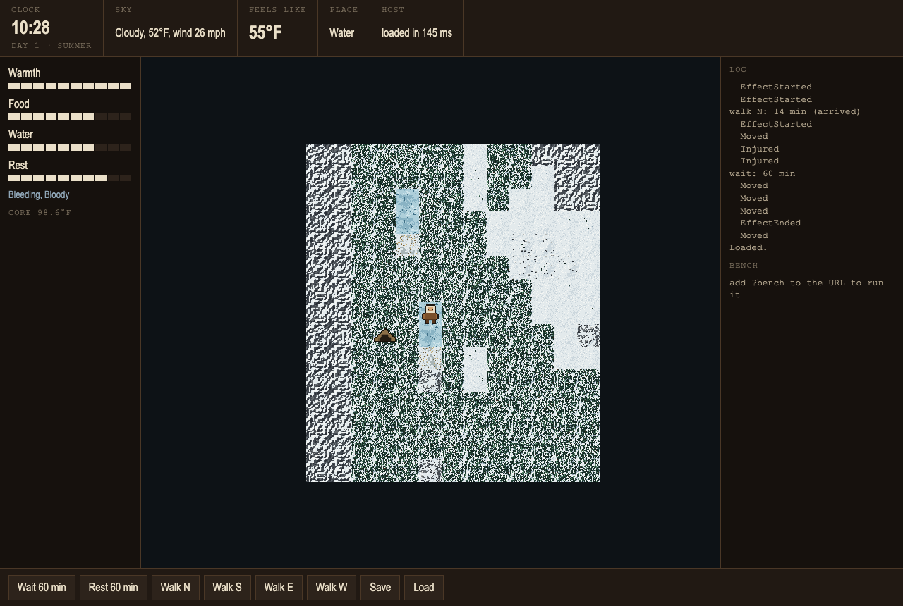

# Web.Spike report: can `rebuild/Sim` run in the browser?

*Throwaway spike, 2026-11-21. Written by the spike agent, saved by the orchestrator.*

**Yes.** The unmodified Sim runs in Chrome under both AOT (`RunAOTCompilation`) and the
interpreter. Its results match native except for two last-digit floats, and save and load work.
AOT steps the world about 8x slower than native, the interpreter about 20x. A normal action still
takes 5-40 ms.

**Recommendation:** in-browser wasm with an AOT build, the runtime in a Web Worker. Write the UI's
client interface as async from the start, so a server can replace the worker later as a one-file
change.

## Numbers

Apple Silicon (osx-arm64), Chrome `--headless=new`, .NET 10 (native 10.0.11, wasm runtime
10.0.15). Seed 1, player waiting at camp, 27-28 agents in the world. Timing uses Stopwatch inside
.NET and `performance.now()` for start-up and `Act`. Runs were made at load average 5-11; an
earlier run at 13-18 agreed within a few percent.

Between hours of the 30-day Advance, the bench tops up the player's food, water, rest and core
temperature, because a player waiting 30 days in the open dies and Step refuses a dead player. The
rest of the world is untouched.

| | Native, JIT warmed | Native, cold process | wasm AOT | wasm interpreter |
|---|---|---|---|---|
| ms per sim min, `Step(Wait,60)`, world start | 0.061 | 0.128 | 0.217 | 0.607 |
| ms per sim min, `Step(Wait,1)` x60, world start | 0.046 | 0.100 | 0.180 | 0.478 |
| ms per sim min, `Step(Wait,60)`, after 30 days | 0.030 | 0.021 | 0.276 | 0.587 |
| ms per sim min, `Step(Wait,1)` x60, after 30 days | 0.025 | 0.026 | 0.283 | 0.598 |
| 30-day `Advance` (43,200 min) | 2.15 s | 2.34 s | 11.6 s | 26.1 s |
| One `Advance` day: day 1 / mean of last 10 | 158 / 48 ms | 296 / 49 ms | 458 / 403 ms | 1139 / 892 ms |
| `Act` "wait 60" through the boundary (step + view JSON + interop), 5 calls | n/a | n/a | 48, 14, 24, 12, 13 ms | 101, 40, 71, 38, 33 ms |
| `World.New` (content already loaded) | 55 ms | 274 ms | 116 ms | 181 ms |
| `Save.ToJson` / `FromJson` after 30 days | 6 / 13 ms | 103 / 43 ms | 36 / 53 ms | 89 / 135 ms |
| Save size after 30 days, raw / gzip | 793 KB / 87 KB | same | same | same |
| Download, brotli, cache off | n/a | n/a | 4.51 MB (19.2 MB decoded) | 2.25 MB (7.4 MB decoded); 1.62 MB with `InvariantGlobalization` |
| Pixel art for the 15x15 view | | | 125 KB | 125 KB |
| Start-up on localhost: runtime ready / first view | n/a | n/a | 147 / 599 ms | 66 / 995 ms |
| ... of which `NewGame` (content tables, map generation, world, view) | | | 447 ms | 919 ms |
| Publish time | | | 70 s | ~15 s |

- **Steady state:** AOT is about 8x native (0.28 vs 0.03 ms per sim minute; 403 vs 48 ms per day).
  The interpreter is about 2x AOT.
- **Native's slow first day:** JIT warm-up plus caches built on first use. Even warmed, day 1
  costs 3-6x day 30. wasm shows only the cache effect, about 1.15x.
- **AOT download size:** the AOT build downloads twice as much. `dotnet.native.wasm` grows from
  0.9 to 3.2 MB brotli, and the IL assemblies still ship.
- **Smaller download:** `InvariantGlobalization` (now on in `Web.csproj`) drops ICU, taking the
  interpreter build from 2.25 to 1.62 MB. AOT with it was not measured; expect about 3.9 MB.
- **Start-up time** excludes the network. Most of it is `NewGame`'s first call: reflection JSON
  parsing of the content tables, then map generation. The runtime itself is ready in under
  150 ms.

### What that means for the UI (AOT; the interpreter costs about 2x)

| Action | Cost |
|---|---|
| Walk one tile (about 14 min) | about 4 ms |
| Wait or rest one hour, including the view | about 15 ms |
| Sleep 8 hours | about 130 ms: a visible stall on the UI thread, so run it in a worker or chunk it |

For animated time, the budget is about 50 sim minutes per 60 fps frame.

**Watch the agent count:** cost grows with the number of agents, and Phase 4 NPCs eat into the
browser's headroom more than a server's.

## What failed in wasm, and the fix

| Problem | Symptom | Fix |
|---|---|---|
| No `wasm-tools` workload; system SDK is root-owned | `workload install`: "Inadequate permissions" | A private SDK plus the workload (see README). A dev machine or CI installs it once. |
| The `wasmbrowser` template targets net8.0 | n/a | Set `net10.0`. |
| Sim's reflection JSON trips the trimmer (`Content.cs`, `Content.Tables.cs`, `Save.cs`, `Agent.cs` `SplitOff`'s JSON deep copy); the repo-wide `TreatWarningsAsErrors` makes those warnings errors | Publish fails: IL2026, IL2075, IL2071, NETSDK1144 | **Spike:** `ILLinkTreatWarningsAsErrors=false`, `SuppressTrimAnalysisWarnings=true`, `<TrimmerRootAssembly Include="Sim"/>`. **Real fix:** a source-generated `JsonSerializerContext` for World and the content tables. That is trim-safe and probably cuts `NewGame`'s cold cost. |
| Trimmed wasm turns off reflection JSON by default | With it off, `NewGame` throws `ManagedError` | `<JsonSerializerIsReflectionEnabledByDefault>true</...>` for now; the same long-term fix as above. |
| JSExport calls run synchronously on the UI thread | A long `Act` freezes the page | Run the runtime in a Web Worker and `postMessage` the same five calls. Not built. |

**Worked without changes:**
- No threading needed: Sim has no `Parallel`, `Thread` or `Task.Run`.
- No file IO: content comes from embedded resources.
- `System.IO.Compression` and `Stopwatch` work.
- `ToJson(FromJson(json)) == json` in both builds.
- Running on after a load gives byte-identical saves.

## Determinism

After 30 days, the native and wasm saves differ in exactly two doubles, on one tile's ground-water
ledger:

```
Tiles["3,40"].Ground.WaterOverflowedM  native 0.032536793540320685  wasm 0.03253679354032041
Tiles["3,40"].Ground.WaterDrainedM     native 0.49033458865308094   wasm 0.4903345886530805
```

The interpreter and AOT agree byte for byte. The likely cause is floating point that is not
bit-exact across platforms: arm64 fused multiply-add, or `Math.Pow`/`Exp`. This matters only if
cross-host replay does: "seed plus command list" bug reports, golden tests in the browser, or a
server checking a client. If it does, it needs a decision record: either accept per-host results,
or pin the operations that differ.

## The boundary as built

`Host/GameHost.cs` is a plain `net10.0` class with no wasm dependency:

```csharp
public sealed class GameHost
{
    public string NewGame(int seed);       // -> view JSON
    public string Act(string actionJson);  // {"kind":"wait"|"rest"|"sleep","minutes":60} | {"kind":"walk","dir":"N"} -> view JSON
    public string View();
    public byte[] Save();                  // World as UTF-8 JSON via Sim's Save.cs
    public string Load(byte[] bytes);      // -> view JSON
}
```

**The view** is plain DTO records, serialized with source-generated camelCase JSON:
- `clock`: day, time, season, sky, air °F, feels-like °F, wind
- `vitals`: warmth, food, water and rest as 0-1, core temperature, effect names
- `place`
- `radius`, `x`, `y`, `tiles`: a 15x15 grid of terrain names
- `marks`: dx/dy plus a kind (species, npc, fire, embers, shelter)
- `actions`: a label plus the action JSON to send back
- `log`, `outcome`

**The JS knows no Sim types.** It posts back whichever `actions[].json` the player clicked, so the
UI never hard-codes the game's verbs.

**Left open for the real boundary:**
- the action vocabulary;
- whether `Act` returns events or receipts beside the view;
- view diffing.

### A server host behind the same interface

An ASP.NET Core minimal API holds one `GameHost` per game with a lock per game (Sim is
single-threaded by design). Routes:
- `POST /games` (seed)
- `POST /games/{id}/act`
- `GET /games/{id}/view`
- `GET`/`PUT /games/{id}/save`

On the JS side, the UI gets one async interface (`newGame`, `act`, `view`, `save`, `load`, each a
Promise) with three possible implementations:
- direct JSExport, as in the spike;
- a Web Worker running the same wasm;
- `fetch` against the routes above.

Write the UI against promises from the start and switching is a one-file change.

## Recommendation

**In-browser AOT wasm, in a Web Worker, behind an async client.**

**Why:**
- 4-15 ms per normal action.
- No server to host or pay for, zero latency, works offline, ships as a static site.
- 87 KB gzipped saves fit easily in IndexedDB.
- The same Sim, unmodified.

**Costs:**
- a first download of 4 MB (AOT) or 1.6 MB (interpreter), cached after;
- about 0.6 s start-up plus the download;
- the `wasm-tools` workload in the build;
- a trimming exemption until Sim's JSON moves to source generation.

**Switch to a small server if:**
- the Phase 4/5 world pushes AOT past about 1 ms per sim minute, or
- the game needs shared worlds, server-held saves or anti-tamper.

**Cheap wins not tried:**
- source-generated JSON for content and saves;
- the `WasmEnableSIMD` and `-O3` link options;
- lazy-loading the AOT native module;
- a tile atlas.


